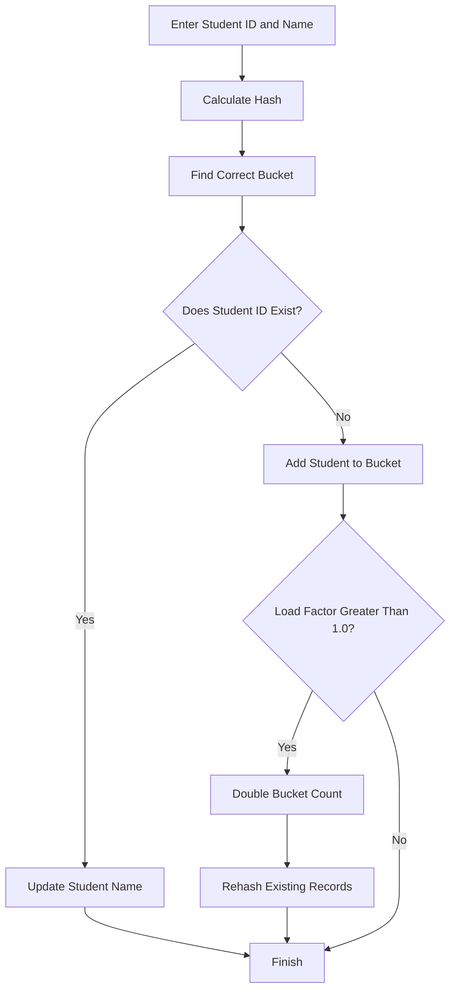

# Design – Hashing and Hash Maps

## 1. Introduction

For our project, we decided to create a Hash Map using C++. We chose a student database as our example because it is a simple way to demonstrate how a Hash Map works.

Our Hash Map stores student IDs and their names. Each student ID is used as a key, and the student's name is the value.

For example:

| Student ID | Student Name |
|---|---|
| 101 | Sahil |
| 102 | Daniel |
| 103 | Ewan |
| 104 | Aman |

The main idea is to make it quicker to find student information without having to search through every record one by one.

## 2. How Our Hash Function Works

A hash function takes a key and works out which bucket it should be stored in.

In our project, we use the modulo operator (`%`) to calculate the bucket number.

This is the code from our `HashMap.cpp` file:

```cpp
std::size_t HashMap::hashFunction(int key) const
{
    return static_cast<unsigned int>(key) % table.size();
}
```

Our Hash Map starts with 10 buckets by default. The modulo operator calculates the remainder, which is used as the bucket index.

For example, when there are 10 buckets:

- 101 % 10 = 1
- 102 % 10 = 2
- 103 % 10 = 3
- 104 % 10 = 4

This means student 101 goes into bucket 1, student 102 goes into bucket 2, and so on.

## 3. How We Store the Data

We use a `std::vector` containing linked lists to store the student information.

This is declared in our `HashMap.h` file:

```cpp
std::vector<std::list<std::pair<int, std::string>>> table;
```

The vector contains the buckets, and each bucket uses a `std::list` to store student records.

Each student record contains:
- Their student ID.
- Their name.

We chose this structure because it allows us to store multiple students in the same bucket if a collision happens.

We also use a counter to keep track of how many student records are stored:

```cpp
std::size_t count = 0;
```

## 4. Handling Collisions

A collision happens when two different keys end up in the same bucket.

For example:

- 101 % 10 = 1
- 111 % 10 = 1

Both student IDs go into bucket 1.

To handle this, we use **separate chaining**.

Instead of replacing the first student, we store both students in a linked list inside the same bucket.

For example:

```text
Bucket 0: NULL

Bucket 1: [101, Sahil] -> [111, John] -> NULL

Bucket 2: [102, Daniel] -> NULL

Bucket 3: [103, Ewan] -> NULL

Bucket 4: [104, Aman] -> NULL

Bucket 5: NULL
Bucket 6: NULL
Bucket 7: NULL
Bucket 8: NULL
Bucket 9: NULL
```

Both students are stored in bucket 1, so neither student's information is lost.

We tested this in our program by inserting student IDs 101 and 111.

## 5. Load Factor and Automatic Resizing

One improvement we made to our Hash Map was adding automatic resizing.

The load factor measures how many records are stored compared with the number of buckets.

We calculate it using:

```cpp
double HashMap::loadFactor() const
{
    return static_cast<double>(count) /
           static_cast<double>(table.size());
}
```

For example, if we have 10 students and 10 buckets, the load factor is 1.0.

In our implementation, the maximum load factor is set to 1.0.

When a new student is inserted and the load factor becomes greater than 1.0, the Hash Map automatically doubles the number of buckets.

For example:

```text
10 buckets
     |
Insert another student
     |
Load factor becomes greater than 1.0
     |
Hash Map doubles its bucket count
     |
20 buckets
```

This helps prevent the buckets from becoming too full as more students are added.

When resizing happens, we also need to move the existing records into their new bucket positions. This process is called **rehashing**.

## 6. Main Functions of Our Hash Map

Our program includes several functions to manage the student records.

### Insert

The insert function adds a new student to the Hash Map.

It calculates the correct bucket and checks whether the student ID already exists.

If the ID already exists, it updates the student's name. Otherwise, it adds a new record.

It also checks the load factor to see whether the Hash Map needs to resize.

### Search

The search function finds a student using their ID.

It calculates the correct bucket and searches through the records stored there.

If the student is found, it returns their name. If not, it returns "Student not found".

### Remove

The remove function deletes a student using their ID.

It finds the correct bucket and searches for the matching record. If the student exists, it removes them and updates the record count.

### Contains

The contains function checks whether a student ID exists in the Hash Map.

It returns `true` if the ID is found and `false` if it is not.

### Display

The display function prints all the buckets and the student records stored inside them.

We use this to see how the data is organised and how collisions are handled.

### Other Functions

We also added functions to return:
- The number of student records (`size()`).
- The number of buckets (`bucketCount()`).
- The current load factor (`loadFactor()`).
- The length of the longest bucket (`longestBucket()`).

These functions help us understand how full the Hash Map is and how records are distributed.

## 7. How Inserting a Student Works

The diagram below shows the steps our program follows when a student is inserted.



For example, if we insert student ID 105 while there are 10 buckets, the program calculates:

105 % 10 = 5

The student will be stored in bucket 5.

If inserting the student causes the load factor to exceed 1.0, the Hash Map will resize and redistribute the records.

## 8. Conclusion

Overall, we created a Hash Map in C++ that stores student IDs and names.

We used separate chaining to handle collisions and added automatic resizing to help manage the number of records as the Hash Map grows.

Our implementation supports inserting, searching, removing and displaying student records. We also added extra functions to check the size, bucket count and load factor.

These features allowed us to explore how Hash Maps work and understand how their performance can be affected by collisions and the number of buckets.
