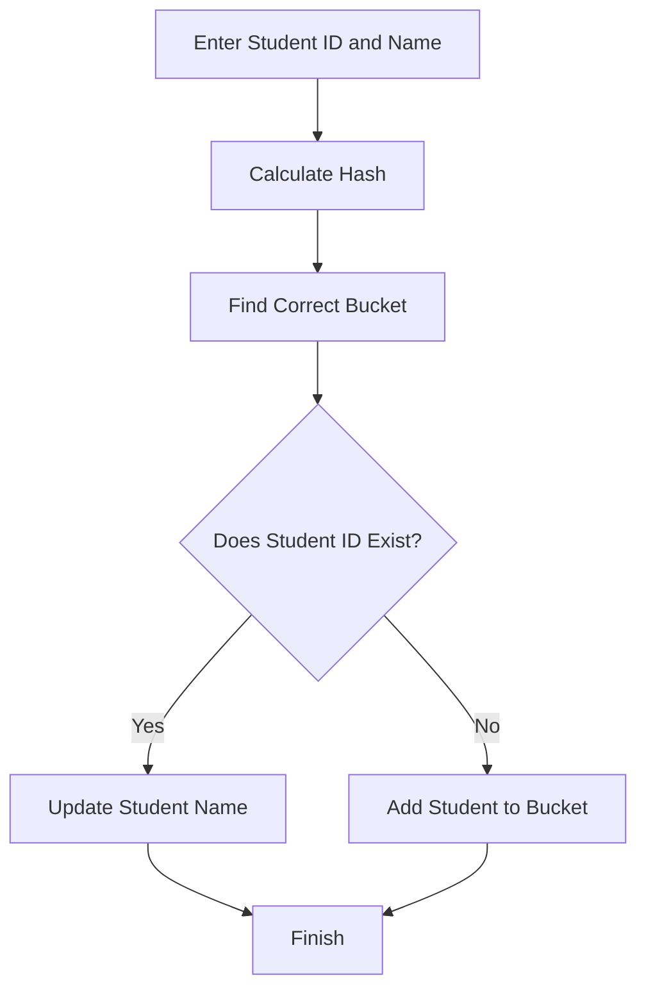

Design – Hashing and Hash Maps

## 1. Introduction

For our project, we decided to create a Hash Map using C++. We chose a student database as our example because it is an easy way to show how a Hash Map works.

Our Hash Map stores student IDs and their names. Each student ID is used as a key, and the student's name is the value.

For example:

| Student ID | Student Name |
|---|---|
| 101 | Sahil |
| 102 | Daniel |
| 103 | Ewan |
| 104 | Aman |

The main idea is to make it easier and quicker to find student information instead of searching through a normal list one by one.

## 2. How Our Hash Function Works

A hash function takes a key and works out where it should be stored in the Hash Map.

In our project, we used the modulo operator (`%`) to calculate the position.

This is the code from our `HashMap.cpp` file:

```cpp
int HashMap::hashFunction(int key)
{
    return key % TABLE_SIZE;
}
```

Our Hash Map has 10 buckets, so we divide the student ID by 10 and use the remainder to decide which bucket it goes into.

For example:

- 101 % 10 = 1
- 102 % 10 = 2
- 103 % 10 = 3
- 104 % 10 = 4

This means student 101 goes into bucket 1, student 102 goes into bucket 2, and so on.

## 3. How We Store the Data

We created an array with 10 buckets. Each bucket can store student information.

In our `HashMap.h` file, we used:

```cpp
static const int TABLE_SIZE = 10;

std::list<std::pair<int, std::string>> table[TABLE_SIZE];
```

We used `std::list` so that more than one student can be stored in the same bucket if needed.

Each student record contains two things:
- Their student ID.
- Their name.

This is important because sometimes two different student IDs can end up in the same bucket.

## 4. Handling Collisions

A collision happens when two different keys end up in the same bucket.

For example:

- 101 % 10 = 1
- 111 % 10 = 1

Both students end up in bucket 1.

To deal with this, we used something called **separate chaining**.

This means that instead of replacing the first student, we store both students in a linked list inside the same bucket.

Here is an example of what our Hash Map looks like when a collision happens:

```text
Bucket 0: NULL

Bucket 1: [101, Sahil] -> [111, John] -> NULL

Bucket 2: [102, Daniel] -> NULL

Bucket 3: [103, Ewan] -> NULL

Bucket 4: [104, Aman] -> NULL

Bucket 5: NULL
Bucket 6: NULL
Bucket 7: NULL
Bucket 8: NULL
Bucket 9: NULL
```

As you can see, both students are stored in bucket 1. Neither student's information is lost.

We tested this in our program by inserting student IDs 101 and 111.

## 5. Main Functions of Our Hash Map

Our program has four main functions.

### Insert

The insert function is used to add a new student to the Hash Map.

It takes the student's ID and name, calculates which bucket they belong in and stores their information.

We also added a check for duplicate IDs. If the ID already exists, the program updates the student's name instead of adding another entry.

### Search

The search function allows us to find a student using their ID.

It calculates the correct bucket and looks through the entries stored there.

If the student is found, it returns their name. If not, it displays "Student not found".

### Remove

The remove function allows us to delete a student using their ID.

It finds the correct bucket, searches for the student and removes their record.

We also tested removing one student from a bucket containing a collision. The other student's information remained there.

### Display

The display function shows all 10 buckets and the students stored inside them.

We used this function to see how the information is organised and to check that collisions were working correctly.

## 6. How Inserting a Student Works

The diagram below shows the steps our program follows when a new student is added.



For example, if we insert student ID 105, the program calculates:

105 % 10 = 5

The student will then be stored in bucket 5.

## 7. Conclusion

Overall, we created a Hash Map that stores student IDs and names using a simple hash function.

We used separate chaining to handle collisions, which allows multiple students to be stored in the same bucket.

Our program can insert, search, remove and display student records. We also tested collisions and duplicate student IDs to make sure the program works as expected.
   
